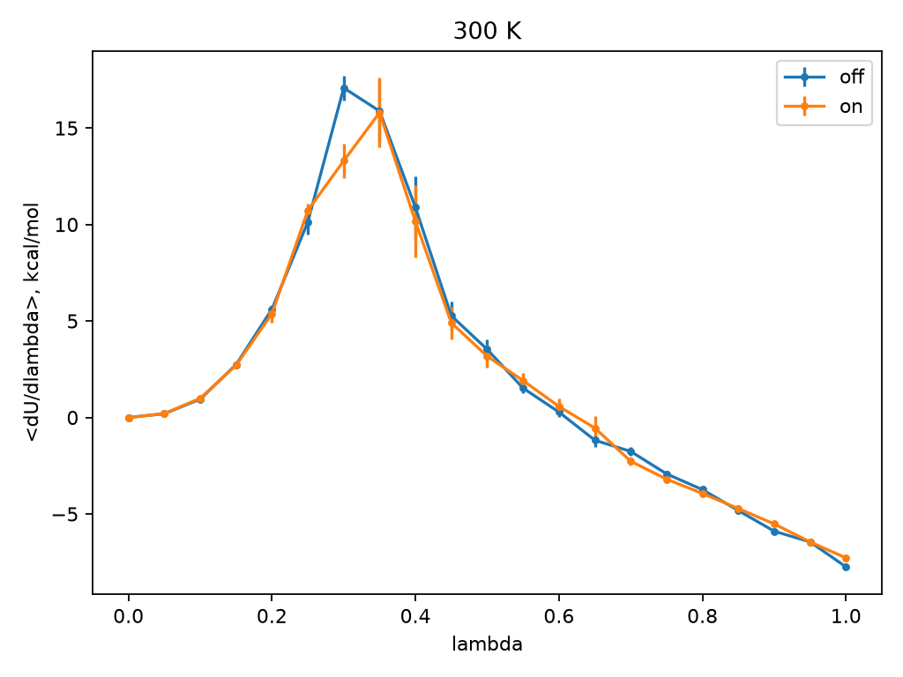
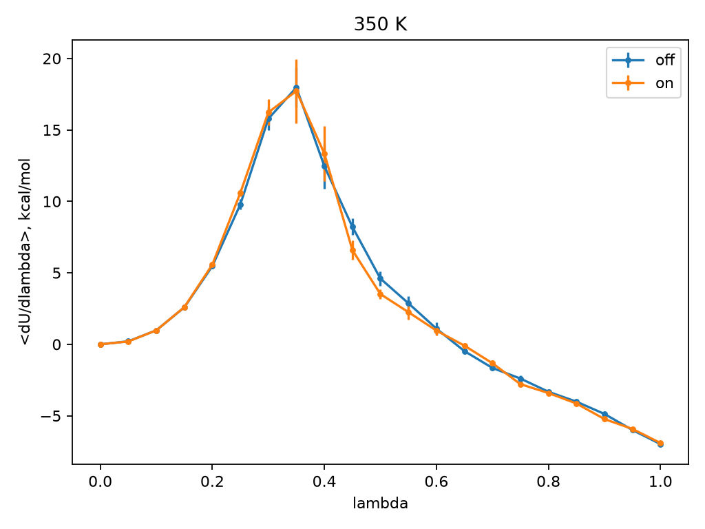
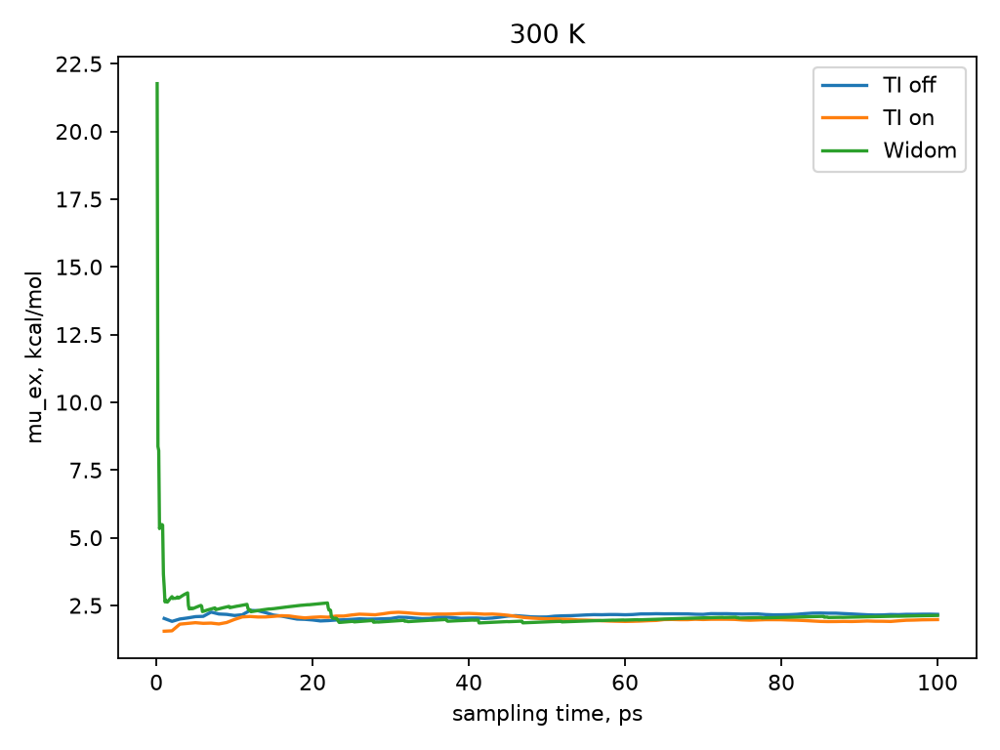
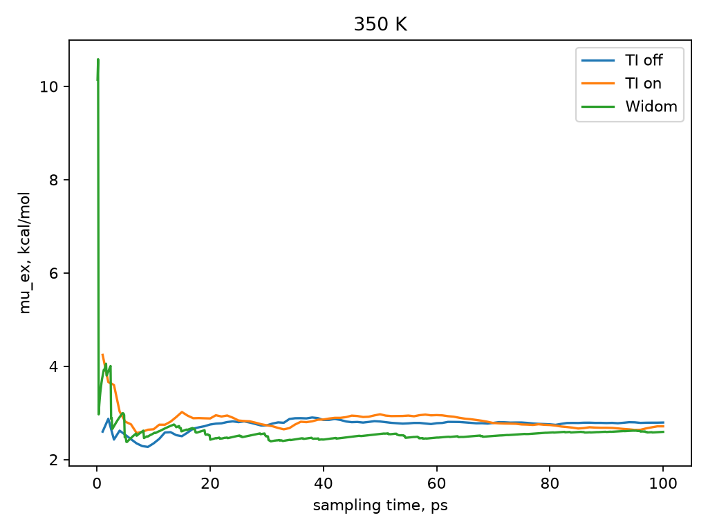

Для ускорения вычислений уменьшен радиус ленарда-джонса

1. Отключение взаимодействий

Взаимодействие метана с водой постепенно отключалось при 300 К изменением λ от 1 до 0
Интегрирование μ_ex = ∫₀¹<dU/dλ>dλ =  2,2 ± 0,1 ккал/моль - энергия сольватации

2. Обратное включение

При обратном включении взаимодействия от λ = 0 до λ = 1 получено μ_ex = 1,978 ± 0,157 ккал/моль, среднее двух направлений составляет 2,075 ккал/моль

3. Повышенная температура и оценка энтальпии и энтропии

Исходная равновесная конфигурация была релаксирована при 350 К, после чего оба направления TI рассчитаны повторно

При отключении получено 2,792 ± 0,127 ккал/моль, при включении — 2,710 ± 0,164 ккал/моль, среднее составляет 2,751 ккал/моль.
По конечным разностям ΔS ≈ −(G(350)−G(300))/50 и ΔH ≈ (G(300)+G(350))/2 + 325ΔS получены оценки при 325 К: ΔS = −13,51 ± 2,93 кал/(моль·К) и ΔH = −1,979 ± 0,955 ккал/моль.

4. Метод Уидома

По 10^6 пробных вставок метана при каждой температуре методом Уидома, μ_ex = −RT ln<exp(−ΔU/RT)>, получено 2,131 ± 0,199 ккал/моль при 300 К и 2,591 ± 0,117 ккал/моль при 350 К.
Оба результата согласуются с TI, а при 300 К отклонения среднего TI и Уидома от экспериментальной оценки ~2,02 ккал/моль составляют соответственно 0,053 и 0,110 ккал/моль.

