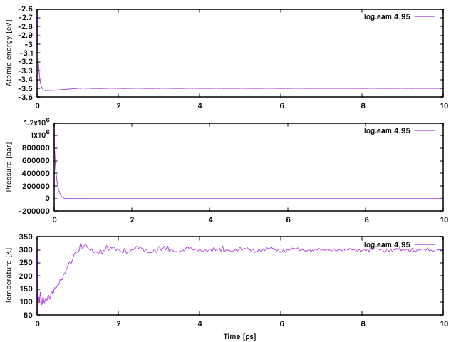
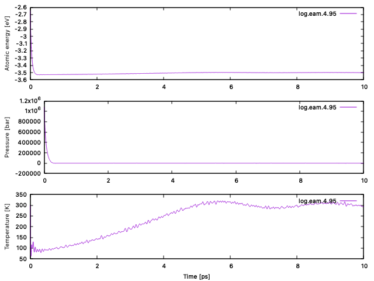
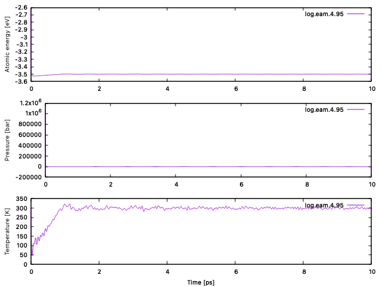
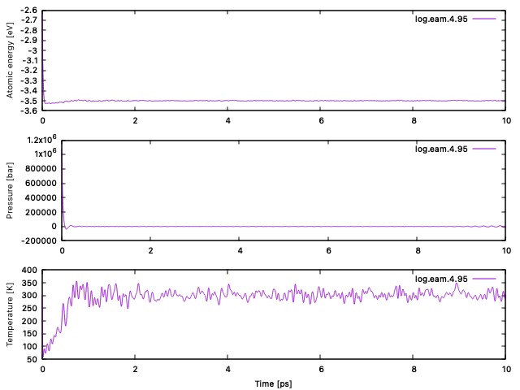
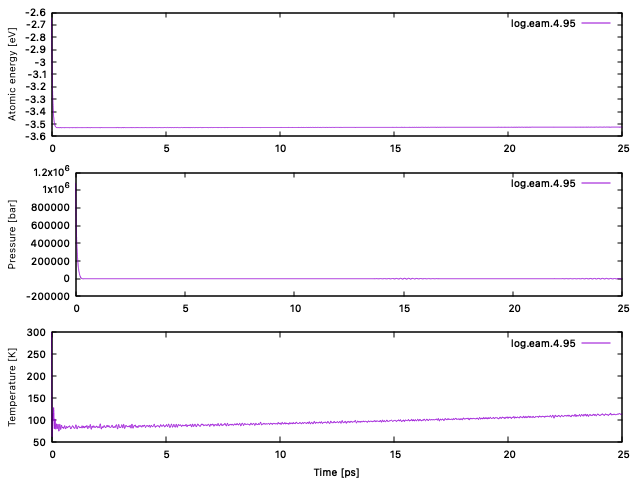
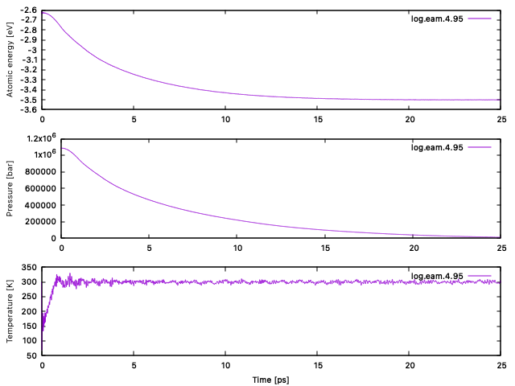
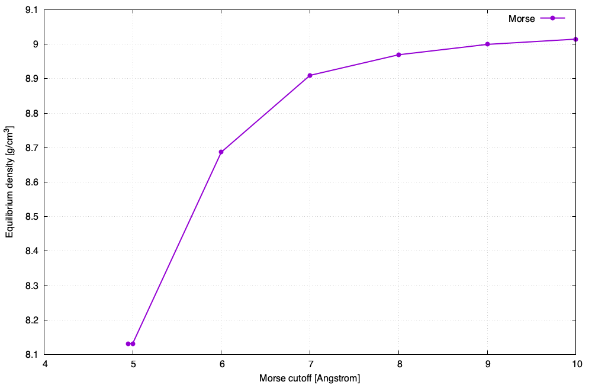
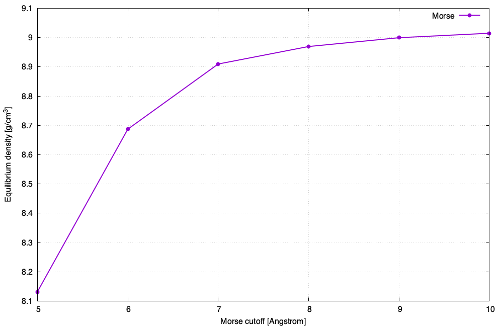

# 1. Время релаксации

Потенциал - eam, скрипт для отрисовки графиков - time.sh, начальные Tdamp = 0.1, Pdamp = 1.0 1.0 1.0

Step          Temp          Press          Volume     v_atomic_volume    Density         PotEng     v_energy_peratom

10000   302.98371      70.572534      47936.642      11.984161      8.8055603     -14001.427     -3.5003567

Из графиков видно, что параметры приходят в равновесие за разное время. Температура приходит в равновесие асимптотически

Поменяем Tdamp = 0.5

Видно, что время выхода на равновесия по температуре и энергии возросло, а по давлению не изменилось

Поменяем Pdamp = 0.1 0.1 0.1

Видно, что время выхода на равновесия по температуре и энергии не изменилось, а по давлению уменьшилось

# 2. Термостат и баростат

## Изменяем размер системы

Уменьшаем размер: region box block 0 4 0 4 0 4

Step          Temp          Press          Volume     v_atomic_volume    Density         PotEng     v_energy_peratom

10000   294.45872     -4170.9         3076.9948      12.019511      8.7796626     -896.23745     -3.5009275

Из графика видно, что увеличилась флуктуация температуры и давления, немного уменьшается время выхода на равновесие

## Слабые баростат и термостат

Tdamp = 10.0

При слишком слабом термостате температура не приходит к равновесию долгое время

Pdamp = 100 100 100

При слишком слабом баростате давление и энергия слишком долго приходят к равновесию

## Сильные баростат и термостат

Tdamp = 0.00001

Появляется ошибка ERROR: Non-numeric pressure - simulation unstable

Pdamp - 0.001 0.001 0.001

Появляется ошибка ERROR on proc 0: Non-numeric atom coords - simulation unstabl

# 3. Плотность от радиуса

Скрипт для запуска расчета - morse_scrypt.sh

Скрипт для отображения графика - density.sh

Видно, что с увеличением радиуса плотность выходит на плато

При pair_modify tail yes расчеты идут дольше, а результат такой же

# Выводы

Из графиков видно, что температура, давление и энергия приходят в равновесие за разное время. При увеличении `Tdamp` температура и энергия устанавливаются дольше. При уменьшении `Pdamp` давление приходит в равновесие быстрее.

При уменьшении размера системы флуктуации температуры и давления становятся больше. При слишком слабом термостате или баростате система долго приходит в равновесие. При слишком сильном термостате или баростате расчёт становится неустойчивым и LAMMPS выдаёт ошибку.

С увеличением радиуса обрезания потенциала Морзе плотность растёт и приближается к плато. Однако между 9 и 10 Å она ещё меняется на `0.0153 г/см³`, поэтому нельзя утверждать, что плато уже достигнуто. При добавлении `pair_modify tail yes` заметного изменения плотности на графиках нет.
